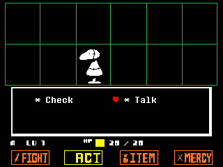
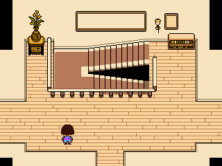

# SoulCE: Undertale for TI-84 Plus CE

An unofficial, in-development calculator port of *Undertale*. This build covers the opening and Ruins through Toriel's house, basement encounter, and exit fade. It has passed the project's CEmu checks; this particular package has not yet been verified on a physical calculator. Gameplay, timing, audio, and the scenes after the exit are still being worked on.

## Download and install

Download [SoulCE-Ruins-dev-2026-10-28.zip](SoulCE-Ruins-dev-2026-10-28.zip?raw=1). Extract it and transfer **`SOULCE.8xp`** and **all 22 `SOULDAT*.8xv` files** to your TI-84 Plus CE. Keep the program and data appvars in Archive. You also need CE C libraries and an assembly-capable launcher appropriate for your calculator OS; those third-party dependencies are not included here.

Back up any save you want to keep, then remove older SOULDAT appvars and SOULSAVE before transferring this build. Do not mix data files from different versions. The ZIP contains a file manifest and more detailed installation notes.

Arrows move; **2nd/Enter** confirms; **Alpha/Del** cancels or skips text; **Mode** opens the menu; **Clear** returns to the title. On the title screen, **Mode** opens the developer room and battle list.

## Screenshots

| Opening dialogue | Battle menu | Toriel's house |
| --- | --- | --- |
|  |  |  |

This repository contains the calculator build and screenshots only. *Undertale* is by Toby Fox. SoulCE is an unofficial fan project.
